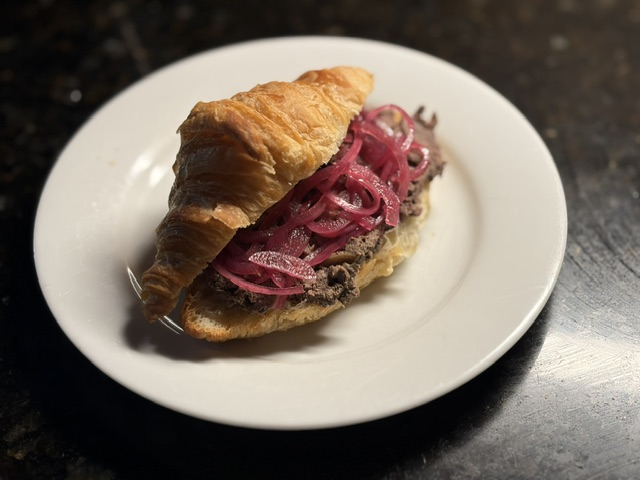

I'm going to be honest: I used to think pâté was something you ordered to seem like you knew what you were doing. Then I made it. It's livers, mushrooms, butter and a blender. That's it.

Bro, you can do it! 

I took this to a dinner party and several folks that hate pâté loved it. The mushrooms tame the liver taste that some people don't like. 

The mushrooms matter most. They add the earthy, savory depth that keeps this from tasting like a plain liver spread, and they're the reason it belongs on this site. I used the left over mushrooms from my visit to [The Woodlands at Phillips Farm. ](https://pennmushrooms.com/blog/2026/09/18/this-family-still-grows-mushrooms-here-100-years-later/)

Serve it on a warm croissant with a pile of pink onions. Open a bottle of champagne while you're at it.

Makes: about 2 cups, enough for 8 to 10 croissants Time: 30 minutes of work, 4 hours of chilling

# Quick Pickled Red Onions

Make these first. They take 5 minutes and keep the pâté from tasting heavy.

## Ingredients

1 large red onion, sliced thin

¾ cup red wine vinegar

¾ cup water

1 tbsp sugar

1 tsp kosher salt

5 or 6 black peppercorns (optional)

## Method

Pack the sliced onion into a clean jar - I used a mandilion for easy and consistent slicing. 

Heat the vinegar, water, sugar and salt in a small pan until the sugar and salt dissolve. It doesn't need to boil.

Pour it over the onions and press them down so they're covered.

Wait 30 minutes, until they turn bright pink. Use them right away, or refrigerate for up to 2 weeks.

The Pâté

## Ingredients

1 lb chicken livers, trimmed and patted dry

8 oz cremini mushrooms, sliced (shiitake or a mix is great too, and I'd lean toward whatever your local farm has)

1 stick (8 tbsp) unsalted butter, plus 3 tbsp more for sealing the top

1 large shallot, finely chopped

2 garlic cloves, minced

1 tbsp fresh thyme leaves

¼ cup brandy or cognac

¼ cup heavy cream

1 tsp kosher salt, plus more to taste

½ tsp black pepper

Croissants, for serving

# The Pâté

## Method

**Cook the mushrooms first.** Melt 2 tbsp of the butter in a large skillet over medium-high heat. Add the mushrooms with a pinch of salt and don't touch them for 3 minutes. Stir and cook until they're browned and the liquid is gone, about 8 minutes total. Scoop them into a bowl.

**Soften the shallot.** Add 2 more tbsp butter to the pan, then the shallot, garlic and thyme. Cook for 2 minutes until soft and fragrant.

**Cook the livers.** Turn the heat to medium-high and add 2 more tbsp butter. Add the livers in a single layer and cook 3 to 4 minutes per side until browned outside and cooked through, with no pink in the middle. Chicken livers should be fully cooked.

**Deglaze with the brandy.** Take the pan off the heat before you pour it in. Brandy near a flame can flare up, and I learned that the hard way. Put the pan back on the heat and let it bubble for a minute, scraping up the brown bits.

**Blend.** Put the livers, shallots, mushrooms and all the pan scrapings in a food processor. Add the cream, the last 2 tbsp of soft butter, the salt and the pepper. Blend until completely smooth, about 2 minutes, scraping down the sides. Taste and add salt until it tastes like more of itself.

Strain, if you want to. Pushing it through a fine sieve takes 5 minutes and makes it silkier. I skip this half the time and nobody has complained.

**Pack and seal.** Spoon it into a jar or small crock and smooth the top. Melt the extra 3 tbsp butter and pour it over the surface to seal it.

**Chill for at least 4 hours.** It's better the next day. It keeps about 5 days in the fridge under the butter seal.

# Putting It Together

Split a croissant and warm it for 3 minutes in a 350°F oven. Spread on a generous layer of pâté, pile on the pickled onions, and close it. A few cracks of black pepper never hurt.

## The Champagne

Bubbles and acid cut through the richness of the liver and butter, which is why this works so well.

Best bet: a brut or extra brut Champagne, especially a blanc de blancs. It's crisp and lean enough to keep up with the pâté.

Easier on the wallet: a Crémant (from Burgundy or Alsace) or a dry Cava. I won't tell anyone.

Skip: anything sweet, such as demi-sec or most Prosecco. The pâté needs dry.

Serve it cold, in a real glass if you can. Take one bite, then one sip, then repeat until the croissants are gone.

Want more recipes built around Pennsylvania mushrooms? [Join the club](https://pennmushrooms.com/#join) and get five free ones.
